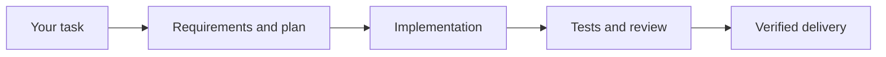

# All in One

**Take a backend idea from requirements to tested delivery with one Codex plugin.**

Built by Om Denkar. Open source, with 55 skills for backend engineering, AI agents, durable jobs, data pipelines, review and release. Start with one task; use the focused stages when you need more control.

[Get started](#quick-start) · [Explore the skills](#skill-catalog) · [Contribute](CONTRIBUTING.md) · [License](LICENSE)

## Quick start

Requirements: Codex with native plugin support. Bundled Python helpers require Python 3.10+. The optional REA integration requires Node.js and npm, and downloads its pinned runtime on first use.

Install directly from GitHub:

```sh
codex plugin marketplace add omdenkar2-ui/all-in-one
codex plugin add all-in-one@all-in-one
```

Open a fresh Codex chat and try:

```text
Use $all-in-one:complete-destruction to build a task-processing API
with resumable jobs and idempotent callbacks. Implement it, test failure
recovery, resolve review findings, and deliver a verified local result.
```

For a smaller first task:

```text
Use $all-in-one:aio-review to review my current backend changes.
Show actionable findings with evidence from the code.
```

Or paste this into Codex:

```text
Install All in One from https://github.com/omdenkar2-ui/all-in-one
using native Codex plugin installation. Add that repository as a
marketplace, then install all-in-one@all-in-one.
```

Native installation includes the supporting files, knowledge library and REA tool registration. To install a downloaded or cloned copy, open its repository folder and use `codex plugin marketplace add .` followed by the same plugin install command.

## How it works



One controller follows the task through each needed stage. Focused skills handle architecture, implementation, diagnosis, testing and review. Checks and evidence determine whether work is complete. Delivery follows the destination you requested, such as a local change or a pull request.

## What's included

All in One **1.6.0** is a backend Codex plugin for APIs, AI agents, durable workflows, data pipelines, databases and algorithms. It contains **55 skills**: 42 focused `aio-*` stages, the main router and Complete Destruction, seven retained backend entrypoints, three optional mobile-launch specialists, and REA reverse engineering. The [machine-readable skill catalog](skill-catalog.json) records the complete installed suite.

**Complete Destruction** carries an accepted task from one prompt through requirements, architecture, an executable plan, implementation, tests, ordered review, verified delivery and useful learning. One controller owns the run; specialists return evidence to it. Existing implementation authorization stays effective across ordinary phases. Missing material facts, required tests or independent review remain visible blockers.

The package also includes nine backend playbooks, **50 source-backed patterns** in JSON/SQLite, structural plan and completion gates, a bounded local check runner, and a fixed-protocol backend comparison runner. It provides engineering guidance and local tools; execution uses the host's existing model, file, shell and delegation capabilities.

## Use

Invoke a skill with the native plugin prefix, or select it in Codex:

> Use $all-in-one:complete-destruction to build a tenant-isolated document-processing backend with resumable jobs and idempotent callbacks. Implement every accepted unit, prove recovery and authorization behavior, resolve review findings, and deliver the verified local result.

> Use $all-in-one:aio-brainstorm to compare viable backend approaches for this agent workflow and produce bounded requirements with observable acceptance.

> Use $all-in-one:aio-plan to turn this exact backend contract into owned implementation units with precise interfaces, dependency order and meaningful red/green checks.

For state/tool authority and recovery design, use `$all-in-one:aio-architecture`. A standalone brainstorm, architecture, spec or plan request produces its requested artifact; it does not authorize implementation. An already authorized end-to-end run continues once its prerequisites are met. The plugin preserves the current stack and adds an orchestration framework only when the actual contract justifies it.

## Skill catalog

Each name below resolves to `skills/<name>/SKILL.md`. The [catalog JSON](skill-catalog.json) is the complete index; the core router links the substantive entrypoints.

| Area | Skills | Work owned |
| --- | --- | --- |
| Intent and design | `aio-ideate`, `aio-brainstorm`, `aio-spec`, `aio-architecture`, `aio-prototype` | Alternatives, requirements, interfaces, critical traces and bounded experiments |
| Planning and isolation | `aio-plan`, `aio-plan-review`, `aio-autoplan`, `aio-worktree` | R/U/V coverage, exact interfaces, owned files, dependencies and engineering-last plan review |
| Implementation | `aio-work`, `aio-tdd`, `aio-test`, `aio-api`, `aio-agents`, `aio-pipelines`, `aio-data`, `aio-algorithms` | Ordered execution, observed red/green tests and backend domain behavior |
| Diagnosis and improvement | `aio-debug`, `aio-optimize`, `aio-simplify`, `aio-security` | Causal reproduction, measured performance, simpler code and trust-boundary checks |
| Review and evidence | `aio-review`, `aio-doc-review`, `aio-verify`, `aio-proof`, `aio-checkpoint`, `aio-benchmark`, `aio-test-audit`, `aio-devex-review`, `aio-qa`, `aio-qa-only` | Spec/risk review, functional QA, fresh acceptance evidence, test value, developer interfaces, structural gates and controlled comparisons |
| Delivery and operations | `aio-commit`, `aio-ship`, `aio-ci`, `aio-feedback`, `aio-release`, `aio-observe`, `aio-canary` | Scoped commits, requested delivery, current-head CI, rollout and bounded backend observation |
| Continuity and learning | `aio-compound`, `aio-handoff`, `aio-resume`, `aio-explain` | Retrievable causal lessons, source-bound recovery and code-grounded explanation |
| Controllers | `all-in-one`, `complete-destruction` | Adaptive routing and the one-prompt full pipeline |
| Retained backend names | `backend-plan`, `agent-workflows`, `backend-pipelines`, `backend-algorithms`, `backend-debug`, `backend-review`, `backend-verify` | Existing entrypoints retained alongside the expanded AIO suite |
| Artifact investigation | `reverse-engineer-anything` | REA evidence for supplied app artifacts, binaries, managed code and requested runtime behavior |
| Optional mobile launch | `launch-readiness`, `apple-appstore-reviewer`, `play-policy-insights` | Submission dossier, Apple review and Google Play policy analysis |

Frontend design and UI construction are outside the workflow. Mobile-launch auditing is retained for an explicitly requested release; an ordinary backend change does not acquire a store audit. Complete Destruction's name grants no permission to delete data or publish.

## REA analysis

> Use $all-in-one:reverse-engineer-anything to inspect this app package, explain how its search works, and show the evidence.

The package includes REA 6.4.0's matching workflow skill, references and a native
Codex MCP registration. Node.js and npm are required; the portable launcher runs
the pinned REA runtime through npm. A refreshed chat or app restart loads the new
tools. Static JavaScript and managed analysis are available without a native
disassembler; native decompilation requires a separately configured provider.
REA is selected for artifact evidence, with findings returning to the current
All in One controller when part of an authorized backend build.

The archive includes instructions and registration, with npm downloading the
runtime if needed. No analysis engines are bundled. See
[integration details](skills/all-in-one/references/rea-integration.md) and
[source provenance](integrations/rea/provenance.json).

## Resource use

The [backend mode directory](skills/all-in-one/references/modes.md) retains useful gstack names and selection semantics: scope expansion/hold/reduction, ordered Autoplan, Full/Quick/Regression QA and Quick/Standard/Exhaustive repair tiers, QA Only, DX expansion/polish/triage, scoped security/doctor/offline work, canary baseline/quick/duration, configured health and advisory Careful/Freeze/Guard. AIO keeps HOLD SCOPE as its default and uses backend evidence. Gstack's runtime, mandatory outside-model voices and hook enforcement are not bundled.

> Use $all-in-one:aio-autoplan in HOLD SCOPE to prepare and independently review the backend plan.

> Use $all-in-one:aio-qa --quick to exercise the changed worker contract and repair authorized high-severity defects. Keep all accepted recovery and tenant checks.

> Use $all-in-one:aio-qa-only --regression <previous-report> to replay its failures and report current backend effects without applying fixes.

Mode selectors are prompt instructions, separate from the resource profiles below. The selected stage inherits the original journal, spent counters and remaining deadline. Load only that stage's relevant reference; choosing a mode does not launch the entire skill suite.

The default **thorough** profile targets 24,000 aggregate model tokens, at most four implementer and six reviewer dispatches, two reviews per unit, two repair waves and 15 minutes of wall-clock run time. Lean and balanced alternatives target 6,000 and 12,000 tokens. These are ceilings, not instructions to consume every allowance. Small tasks normally use one coherent implementation unit and two independent review jobs, with spec and risk reported as ordered passes.

The [resource contract](skills/all-in-one/references/resource-budgets.md) requires progressive loading, source-bound evidence reuse and a resumable checkpoint when mandatory work cannot fit. The journal helper reserves counted dispatches and repairs before launch and preserves spent counters across resumes. It does not intercept model calls; reported tokens remain a soft target, with missing usage marked unknown. A host must enforce process deadlines and actual dispatch discipline.

Each run selects checks from affected mechanisms rather than invoking every specialist. API/worker functional probes and relevant security lenses fit within the existing review jobs. Test retirement audits apply to actual suite-value concerns; developer-experience checks apply to affected API/SDK/CLI flows; a canary applies to requested deployment observation. Focused repair checks and valid final evidence are reused. Twenty percent of the soft target is kept for required closing reviews, checks and handoff. The `assess` helper rejects estimates that would consume this reserve; it cannot account for unreported provider usage or guarantee a billing ceiling.

```text
python skills/all-in-one/scripts/run_budget.py init run/budget.json --root workspace --profile thorough
python skills/all-in-one/scripts/run_budget.py assess run/budget.json --root workspace --estimated-tokens 1200
python skills/all-in-one/scripts/run_budget.py reserve run/budget.json --root workspace --event-id review-U1 --kind reviewer --unit U1
python skills/all-in-one/scripts/run_budget.py check run/budget.json --root workspace
```

## Engineering foundations

The expanded suite adopts Compound Engineering's staged discovery, authoritative work source, controller integration, recovery state and delivery follow-through. It adopts Superpowers' concrete interfaces, test-first behavior changes, independently checkable units, spec-before-risk review and systematic diagnosis. From locally installed gstack procedures it adapts explicit failure-mode review, backend functional QA, agent/plugin supply-chain analysis, bounded test-value and DX audits, reliable checker evidence and baseline-aware backend canaries. [Upstream design notes](skills/all-in-one/references/upstream-design.md) explain the inspected source features and how conflicts were resolved.

Backend-specific execution adds typed agent state/reducers, server-bound run/operation identities, proposal-versus-tool authority, tenant isolation, durable-effect reconciliation, budget exhaustion and workflow/schema compatibility. Architectural decisions are exercised through concrete success/failure traces and requirement-linked tests rather than framework checklists alone.

These additions increase explicit coverage; they do not establish that the plugin produces better applications than Compound Engineering or Superpowers. Comparative claims require actual equivalent runs under the [AIO Benchmark protocol](skills/aio-benchmark/references/protocol.md). The runner records local evaluator observations and declared settings; it does not launch or attest hosted model generation. This release's benchmark infrastructure is not itself a completed comparative result.

## Local tools and evidence limits

Python 3.10+ is required for bundled helpers. From the package directory:

```text
python skills/all-in-one/scripts/knowledge.py search "idempotency recovery" --json
python skills/all-in-one/scripts/knowledge.py search "tenant" --domain security
python skills/all-in-one/scripts/knowledge.py check
python skills/all-in-one/scripts/plan_gate.py "<plan.json>" --root "<workspace>" --json
python skills/all-in-one/scripts/check_receipt.py "<receipt.json>" --root "<workspace>" --json
python skills/launch-readiness/scripts/launch_gate.py "<launch-report.json>" --root "<app-workspace>" --json
python -m unittest discover -s tests -v
```

Resolve helper paths from the package location when invoked elsewhere. The canonical pattern/source records live under `skills/all-in-one/knowledge/`; after changing them, rebuild with `knowledge.py build --force` and run `check`. SQLite is a search index, not an application database. Backend knowledge and structural helpers use the Python standard library and work offline. Launch audits recheck live policies; the copied Google report generator may fetch public Play Store data. A benchmark evaluator may need its own declared environment.

The plan, completion and launch starters deliberately cannot pass. The plan gate checks current source identity, R/U/V links, acyclic dependencies and declared file ownership; independent semantic review determines execution readiness. The completion/launch gates check their defined evidence structure, source/build hashes and contained files. They cannot authenticate recorded commands, prove coverage, certify legal conclusions or verify remote approval. The controller must inspect actual code, run the tests and observe the requested destination.

Pre-delivery implementation verification and final completion are separate claims. A correct local change can await requested PR/CI/deployment evidence. Unavailable independent review cannot be relabeled as a completed review. See the [stage contract](skills/all-in-one/references/stage-contracts.md), [plan schema](skills/aio-plan/references/plan-schema.md) and [launch-report format](skills/launch-readiness/references/report-format.md).

## Native local installation

With the Codex CLI available:

```text
codex plugin marketplace add "<absolute-path-to-all-in-one>" --json
codex plugin add all-in-one@all-in-one --json
codex plugin list --marketplace all-in-one --json
```

If Codex is not on PATH, use the bundled executable's absolute path. The package provides `.codex-plugin/plugin.json`, `.mcp.json` and a local `.claude-plugin/marketplace.json`. A refreshed chat may be needed to expose an installed update. Avoid a duplicate global skill installation when native registration succeeds.

## Sources and optional launch audit

The backend synthesis draws from installed Compound Engineering **3.27.0** and Superpowers **6.4.2**, plus inspected LangGraph, Temporal, Airflow, Python performance and Supabase PostgreSQL skills. Source URLs, inspected versions/commits, hashes and licenses travel in [backend source provenance](skills/all-in-one/knowledge/sources.json). Pins identify inspected snapshots rather than the newest release; version-sensitive choices require checking the actual project runtime.

Two launch specialists are copied with their resources and licenses intact: [GitHub apple-appstore-reviewer](https://github.com/github/awesome-copilot/tree/143a3d976b3c1603cc8932984d5e1f28501cb5fc/skills/apple-appstore-reviewer), MIT, and [Google play-policy-insights](https://github.com/android/skills/tree/42dc2270e96032bd860bb94511e440aa00a43125/play/play-policy-insights), Apache 2.0. Their per-file hashes are recorded in [vendored provenance](skills/launch-readiness/references/vendored-sources.json).

When requested, Launch Readiness reconciles privacy policies, SDK/backend data inventory, store declarations, account deletion, permissions, reviewer access, release tests and applicable legal facts. It returns submission readiness or specific blockers/review needs. It cannot guarantee store approval or eliminate future legal trouble. No actual mobile application ships with this plugin; each candidate requires its own evidence.

Original files are MIT-licensed; bundled upstream files retain their own terms. See [third-party notices](THIRD_PARTY_NOTICES.md) and [change log](CHANGELOG.md). Package tests validate helpers, failure cases and portability; project correctness, security and launch readiness depend on the implementation and verification actually performed.

## Contributing

Bug reports, focused improvements and documentation fixes are welcome. Start with the [contributing guide](CONTRIBUTING.md), which covers the package layout, local checks and upstream attribution. For sensitive reports, see the [security policy](SECURITY.md).
